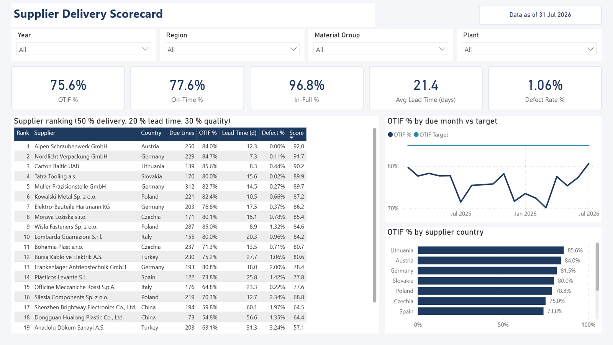
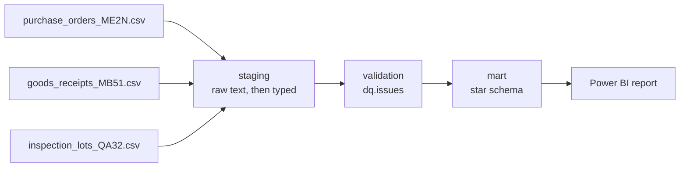
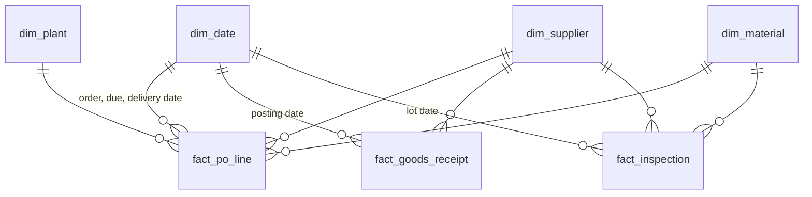
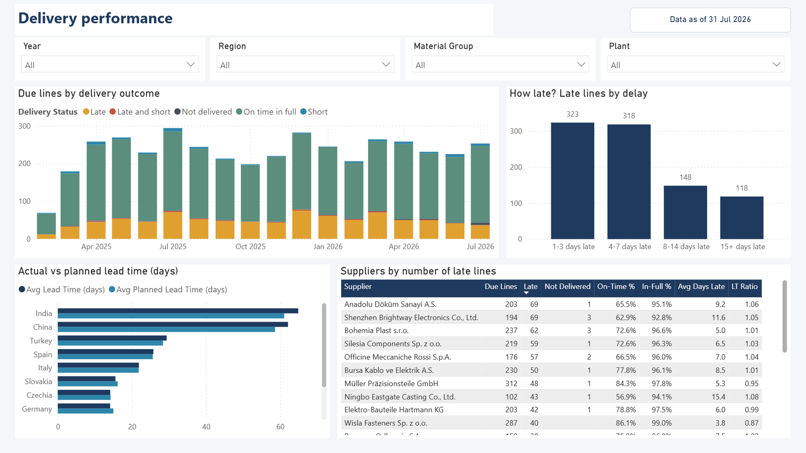
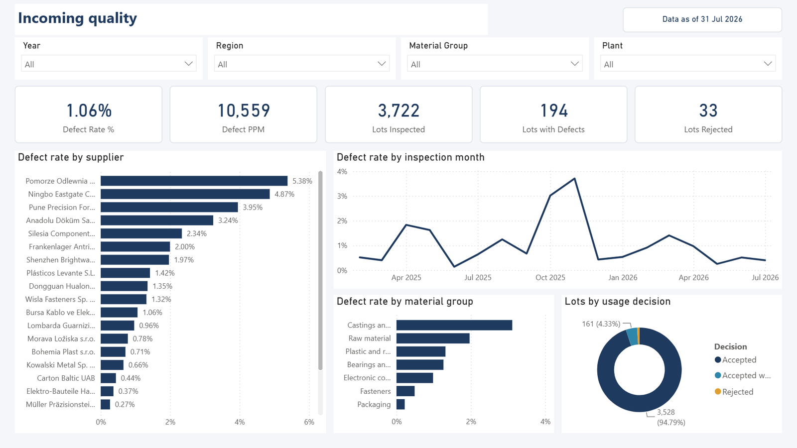
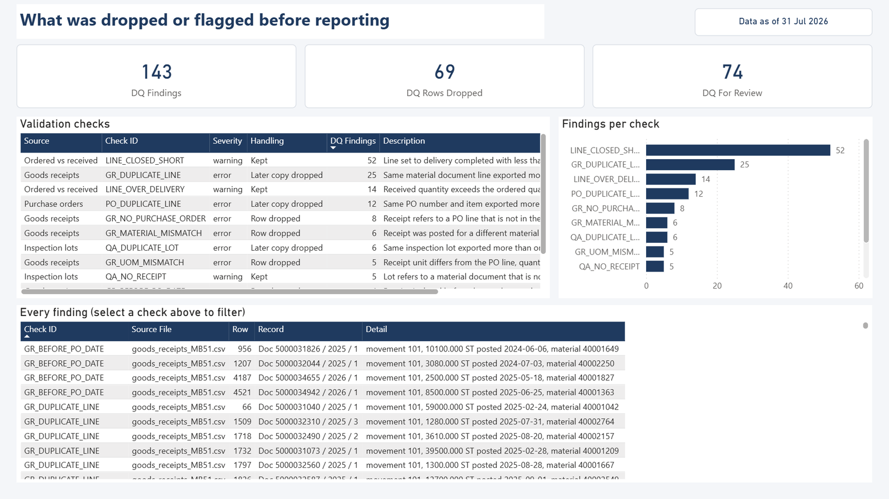

# Supplier Delivery Scorecard

Supplier performance report built from three SAP-style exports: purchase orders, goods receipts and quality inspection lots. It answers one question for a purchasing team: which suppliers deliver on time, in full and without defects?



The exports are consolidated and validated in PostgreSQL, modelled as a star schema, and reported in Power BI.

The data is synthetic. A generator writes exports that look and misbehave like the real thing, so no company data is in this repository.

## How it fits together



| Step | Where | What happens |
|---|---|---|
| Land | `sql/01`, `src/scorecard/load.py` | Each export is loaded as text, one table per file, so a bad cell cannot fail the load |
| Clean | `sql/02` | SAP formatting is undone: `31.07.2026` and `20260731` dates, `1.250,000` numbers, trailing minus, zero-padded keys |
| Validate | `sql/03` | 15 checks. Errors are left out of the marts, warnings are kept and listed |
| Model | `sql/04`, `sql/05` | Three facts and four shared dimensions, on-time and in-full derived per PO line |
| Report | `sql/06`, `powerbi/` | KPI views in SQL, the same KPIs as DAX measures |

## The exports

| File | Layout | Rows | Grain |
|---|---|---|---|
| `purchase_orders_ME2N.csv` | PO item list | 4,295 | PO number + item |
| `goods_receipts_MB51.csv` | Material document list | 4,874 | Document + year + line; movement types 101, 102, 122 |
| `inspection_lots_QA32.csv` | Inspection lot list | 3,756 | Inspection lot |

22 suppliers, 90 materials, 3 plants, orders from February 2025 to July 2026. The files are semicolon separated with technical field names (`EBELN`, `LIFNR`, `MENGE`), and they carry the problems such exports usually have:

- the PO list is Windows-1252, the other two are ASCII
- vendor and material numbers lose their leading zeros in some rows
- two date formats in the same column, and `00.00.0000` for "no date"
- overlapping export runs, so some rows appear twice
- receipts posted against purchase orders that are not in the PO export
- quantity typos that were reversed (102) and posted again
- the vendor name changes over time for the same vendor number

`data/raw/planted_issues.json` lists the keys of every deliberately broken row. The tests compare what the validation finds against that list.

## Validation

Run on the committed exports:

| Check | Severity | Findings | Handling |
|---|---|---:|---|
| Duplicate PO line | error | 12 | later copy dropped |
| Duplicate receipt line | error | 25 | later copy dropped |
| Duplicate inspection lot | error | 6 | later copy dropped |
| Receipt without a PO line in the export | error | 8 | row dropped |
| Receipt for a different material than the PO line | error | 6 | row dropped |
| Receipt in a different unit than the PO line | error | 5 | row dropped |
| Receipt dated before the purchase order | error | 4 | row dropped |
| Receipt with an unreadable date | error | 3 | row dropped |
| Over-delivery beyond 10 % | warning | 14 | kept |
| Line closed with less than 90 % received | warning | 52 | kept |
| Receipt on a deleted PO line | warning | 3 | kept |
| Inspection lot without a receipt | warning | 5 | kept |

69 rows are left out, 74 findings are kept for review. Every finding is in `dq.issues` with the file, row number and record key, and can be exported with `python -m scorecard validate --export findings.csv`. The report has a page for them, so a reader can see what was excluded before trusting the KPIs.

## Model



| Table | Grain | Rows |
|---|---|---:|
| `mart.fact_po_line` | purchase order line | 4,255 |
| `mart.fact_goods_receipt` | material document line | 4,823 |
| `mart.fact_inspection` | inspection lot | 3,750 |

### KPI definitions

- **Due line**: a PO line with a due date on or before the as-of date (the last posting in the exports). All delivery KPIs count due lines only.
- **In full**: net receipts (101 minus 102) reach the ordered quantity minus a 2 % tolerance.
- **On time**: the receipt that completed the line was posted on or before the due date. A receipt that is reversed later does not complete a line.
- **OTIF %**: due lines that are on time and in full, over due lines.
- **Lead time**: order date to the day the line was complete, in calendar days.
- **Defect rate**: blocked plus returned quantity over inspected quantity, for lots with a usage decision. Returns to the supplier (122) count as a quality outcome, not as a short delivery.
- **Supplier score**: 50 % delivery (OTIF), 20 % lead time against plan, 30 % quality, each on a 0 to 100 scale. A component without data is left out and the other weights are rescaled.

Tolerances, weights and the OTIF target live in one table, `mart.kpi_params`, which both SQL and Power BI read.

On the committed data: OTIF 75.6 %, on time 77.6 %, in full 96.8 %, average lead time 21.4 days, defect rate 1.06 %.

## Power BI report

`powerbi/SupplierScorecard.pbip` is a Power BI Project, so the model (TMDL) and the report are text files in this repository instead of one binary.

- Power Query reads the mart tables from PostgreSQL through two parameters (`PgServer`, `PgDatabase`), renames the columns and adds a delay bucket for the delivery page.
- One date table. The PO line fact relates to it three times: due date is the active relationship, order date and delivery date are inactive and used through `USERELATIONSHIP`.
- 41 measures in display folders. The score measures read their weights and caps from the KPI Parameters table.
- `DAXQueries/Supplier scorecard check.dax` returns the scorecard per supplier. Its result matches `mart.v_supplier_scorecard` for every measure and supplier.

| Delivery | Quality |
|---|---|
|  |  |

The fourth page lists the validation checks and their findings:



To open it: start the database and run the pipeline (below), open the `.pbip` file in Power BI Desktop, choose Refresh, and sign in to the database with the user and password from `.env`.

## Run it

Requirements: Python 3.11+, Docker. Power BI Desktop for the report.

```bash
docker compose up -d                      # PostgreSQL on port 5433
python -m venv .venv
.venv/Scripts/activate                    # source .venv/bin/activate on Linux and macOS
pip install -e ".[dev]"
cp .env.example .env

python -m scorecard run                   # load, build and validate
pytest                                    # needs the database
```

`python -m scorecard generate` rewrites the exports. With the default seed it reproduces the committed files byte for byte.

## Layout

```
data/raw/          the three exports and the list of planted issues
data/reference/    plant, material group and country names
sql/               numbered scripts: staging, validation, star schema, views
src/scorecard/     generator, loader, pipeline
powerbi/           Power BI Project: semantic model and report
tests/             pytest suite, runs against the docker-compose database
```

## Next

- Excel workbook with pivot tables over the same model, for questions the report does not answer
